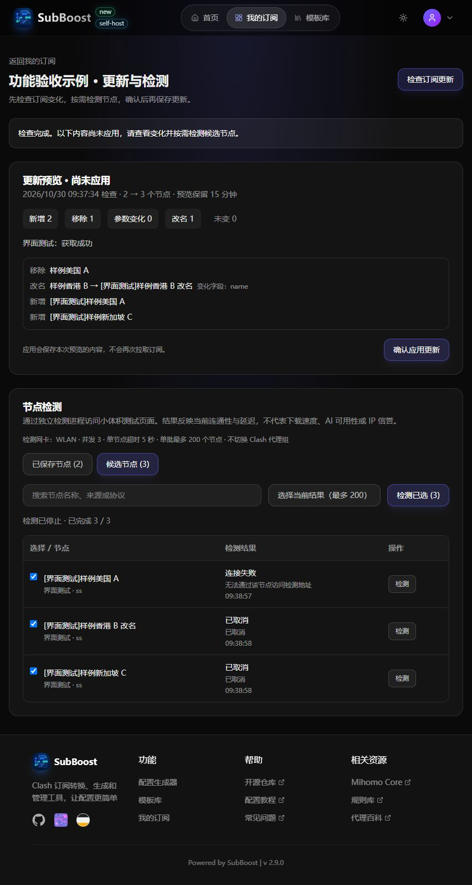

# 检查订阅更新与节点检测

打开“我的订阅”，在需要修改的订阅右侧选择“更新与检测”。这里始终操作所选 SubBoost 订阅，不读取当前 Clash 配置作为订阅来源。



## 检查与预览

1. 点击“检查订阅更新”。程序拉取已保存的订阅源，生成候选节点，不写入已保存配置。
2. 查看新增、移除、改名和参数变化。参数变化只显示字段名称，不显示密码、UUID 等具体值。失败的来源保留旧节点；全部来源失败或结果无效时禁止应用。
3. 可切换“已保存节点”和“候选节点”，先检测候选节点。
4. 点击“确认应用更新”，在确认框中提交。保存的是刚才看到的那份候选结果，不重新拉取；原订阅链接保持不变。
5. 需要使用新内容时，再在 Clash 中更新原订阅。SubBoost 不切换 Clash 配置、修改代理组选择或中断连接。

预览保留 15 分钟，重启 SubBoost 后失效。检查期间或应用前如有其他编辑、刷新，旧预览将被拒绝，需要重新检查。启用了自动更新的订阅必须先点击“改为确认后更新”，关闭该订阅的自动刷新；这不会改变客户端的刷新设置。

直接使用编辑器保存配置属于手动编辑；该功能不对你的编辑额外生成一次订阅更新预览。旧的刷新 API 保留兼容性，新本地界面的更新入口使用预览流程。

## 单个与批量检测

点击节点右侧“检测”可单独测试；选择节点后点击“检测已选”可批量测试。搜索后可选中当前结果，单批最多 200 个，3 个并发，每个超时 5 秒，整个任务最长 5 分钟。点击“停止检测”取消剩余任务。结果显示检测时间、延迟、失败或超时，不自动删除节点或改选线路。

检测访问固定的小体积 HTTPS 测试页面，会产生少量实际流量，不做大文件带宽测试。成功只说明当时能访问该检测地址，不保证其他网站、AI 服务或 IP 信誉。中转依赖和未支持的协议明确显示“暂不支持”，不会被当成断线节点。

程序使用一份临时配置启动独立 Mihomo 进程，禁用 TUN、系统路由、DNS 监听、所有代理监听端口和代理组，只开放带随机凭证的本机控制端口。检测绑定物理网卡；不调用正在使用的 Clash 控制器。完成或取消后关闭进程并清理临时配置。结果属于本机本次检测，不写入配置同步文件；页面重新加载后可以重新检测。

## 首次配置检测核心

使用本机已安装的 Mihomo，程序不自动下载或安装核心。在 `local/.env` 中设置已有程序的绝对路径，例如：

```dotenv
SUBBOOST_MIHOMO_PATH=C:/Apps/ClashVerge/verge-mihomo.exe
```

也可以把已安装的兼容核心放在 `data/runtime/mihomo/mihomo.exe`。程序能唯一识别已联网的物理网卡时自动使用；多网卡机器可以设置：

```dotenv
SUBBOOST_TEST_INTERFACE=Wi-Fi
```

填写系统中实际显示的网卡名称，重启 SubBoost 生效。未正确设置时会禁用检测并说明原因，不回退到当前 Clash 的代理线路。`.env`、检测配置和个人订阅均不入 Git。另一台 PC 需要配置它自己的程序位置和网卡。

## 个人自定义规则

Clash 中手动添加的个人规则应迁入对应 SubBoost 订阅的“自定义规则”，而不是写入所有人共用的默认模板。之后保存加密工作配置，另一台 PC 导入即可同步；不要把个人工作配置或订阅凭证提交 Git。
